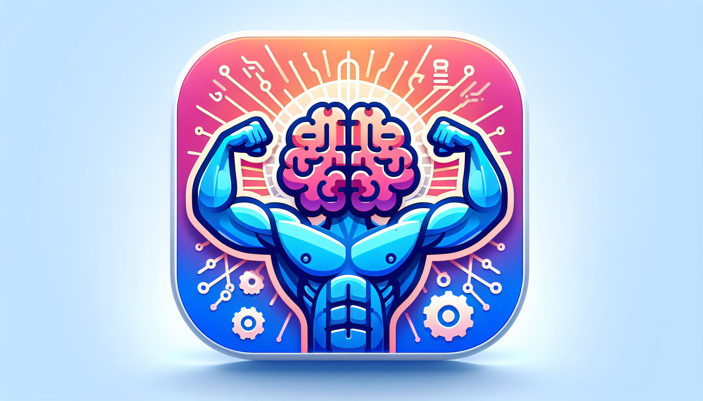

<div id="top">

<!-- HEADER STYLE: CLASSIC -->
<div align="center">



# MINDMUSCLEWEB

<em>Transform Your Fitness Journey with AI Empowerment</em>

<!-- BADGES -->


<em>Built with the tools and technologies:</em>


<br>


</div>
<br>

---

## 📄 Table of Contents

- [Overview](#-overview)
- [Getting Started](#-getting-started)
    - [Prerequisites](#-prerequisites)
    - [Installation](#-installation)
    - [Usage](#-usage)
    - [Testing](#-testing)
- [Features](#-features)
- [Project Structure](#-project-structure)
    - [Project Index](#-project-index)
- [Roadmap](#-roadmap)
- [Contributing](#-contributing)
- [License](#-license)
- [Acknowledgment](#-acknowledgment)

---

## ✨ Overview

MindMuscleWeb is a cutting-edge web application that revolutionizes your fitness journey through the power of artificial intelligence. 

**Why MindMuscleWeb?**

This project aims to provide users with personalized fitness plans, nutrition guidance, and progress tracking, all tailored to individual goals and preferences. The core features include:

- **🏋️‍♂️ Personalized Fitness Plans:** Tailored workout and nutrition plans based on individual goals.
- **🤖 AI-Driven Recommendations:** Real-time insights and suggestions to enhance user engagement.
- **📈 Progress Tracking:** Monitor your fitness journey for motivation and accountability.
- **📱 Responsive Design:** Seamless experience across devices with Next.js and Tailwind CSS.
- **🔧 Modular Architecture:** Easy enhancements and integrations for future scalability.
- **🔍 SEO Optimization:** Improved visibility to attract and engage users effectively.

---

## 📌 Features

|      | Component       | Details                              |
| :--- | :-------------- | :----------------------------------- |
| ⚙️  | **Architecture**  | <ul><li>Next.js framework for SSR</li><li>TypeScript for type safety</li><li>Component-based structure</li></ul> |
| 🔩 | **Code Quality**  | <ul><li>ESLint for linting</li><li>Prettier for code formatting</li><li>Strict TypeScript settings</li></ul> |
| 📄 | **Documentation** | <ul><li>README.md for project overview</li><li>Inline comments for clarity</li><li>Type definitions for components</li></ul> |
| 🔌 | **Integrations**  | <ul><li>Formspree for form handling</li><li>Framer Motion for animations</li><li>Next SEO for SEO optimization</li></ul> |
| 🧩 | **Modularity**    | <ul><li>Reusable React components</li><li>Custom hooks for shared logic</li><li>Separation of concerns in file structure</li></ul> |
| 🧪 | **Testing**       | <ul><li>Jest for unit testing</li><li>React Testing Library for component tests</li><li>Coverage reports enabled</li></ul> |
| ⚡️  | **Performance**   | <ul><li>Code splitting with Next.js</li><li>Optimized images with Next.js Image component</li><li>Tailwind CSS for utility-first styling</li></ul> |
| 🛡️ | **Security**      | <ul><li>Environment variables for sensitive data</li><li>Secure form submissions via Formspree</li><li>Regular dependency updates</li></ul> |
| 📦 | **Dependencies**  | <ul><li>React, TypeScript, Next.js</li><li>Tailwind CSS for styling</li><li>Testing libraries: Jest, Testing Library</li></ul> |
| 🚀 | **Scalability**   | <ul><li>Next.js for server-side rendering</li><li>Modular architecture for easy feature addition</li><li>TypeScript for maintainable codebase</li></ul> |

---

## 📁 Project Structure

```sh
└── MindMuscleWeb/
    ├── LICENSE
    ├── README.md
    ├── eslint.config.mjs
    ├── jest.config.js
    ├── jest.setup.ts
    ├── next.config.ts
    ├── package-lock.json
    ├── package.json
    ├── postcss.config.mjs
    ├── public
    │   ├── file.svg
    │   ├── globe.svg
    │   ├── images
    │   ├── next.svg
    │   ├── robots.txt
    │   ├── sitemap.xml
    │   ├── vercel.svg
    │   └── window.svg
    ├── scripts
    │   ├── .eslintrc.js
    │   ├── download-fonts.mjs
    │   ├── fetch-images.js
    │   └── generate-sitemap.js
    ├── src
    │   ├── app
    │   └── components
    ├── tailwind.config.js
    └── tsconfig.json
```

---

### 📑 Project Index

<details open>
	<summary><b><code>MINDMUSCLEWEB/</code></b></summary>
	<!-- __root__ Submodule -->
	<details>
		<summary><b>__root__</b></summary>
		<blockquote>
			<div class='directory-path' style='padding: 8px 0; color: #666;'>
				<code><b>⦿ __root__</b></code>
			<table style='width: 100%; border-collapse: collapse;'>
			<thead>
				<tr style='background-color: #f8f9fa;'>
					<th style='width: 30%; text-align: left; padding: 8px;'>File Name</th>
					<th style='text-align: left; padding: 8px;'>Summary</th>
				</tr>
			</thead>
				<tr style='border-bottom: 1px solid #eee;'>
					<td style='padding: 8px;'><b><a href='https://github.com/pateutz1/MindMuscleWeb/blob/master/README.md'>README.md</a></b></td>
					<td style='padding: 8px;'>- MindMuscleWeb## Project Overview<strong>MindMuscleWeb</strong> is an innovative web application designed to enhance your fitness journey through the power of artificial intelligence<br>- This project aims to provide users with personalized fitness plans, nutrition guidance, and progress tracking, all tailored to individual goals and preferences<br>- By leveraging AI technologies, MindMuscleWeb empowers users to make informed decisions about their health and fitness, ultimately leading to more effective and sustainable results.## Purpose of the CodebaseThe codebase serves as the backbone of the MindMuscleWeb application, orchestrating various components that work together to deliver a seamless user experience<br>- It encompasses functionalities such as user authentication, data management, and AI-driven recommendations, ensuring that users receive relevant and actionable insights<br>- The architecture is designed to be modular and scalable, allowing for future enhancements and integrations as the project evolves.In summary, MindMuscleWeb is not just a fitness tool; it is a comprehensive platform that transforms the way individuals approach their health and fitness journeys, making it easier and more effective to achieve their goals.</td>
				</tr>
				<tr style='border-bottom: 1px solid #eee;'>
					<td style='padding: 8px;'><b><a href='https://github.com/pateutz1/MindMuscleWeb/blob/master/next.config.ts'>next.config.ts</a></b></td>
					<td style='padding: 8px;'>- Configures the Next.js application to enhance performance and optimize image handling<br>- By enabling Reacts strict mode, it ensures better error detection and debugging<br>- Additionally, it specifies supported image formats and defines various device and image sizes, facilitating responsive design and improved loading times across different devices<br>- This setup contributes to a robust and user-friendly web experience within the overall project architecture.</td>
				</tr>
				<tr style='border-bottom: 1px solid #eee;'>
					<td style='padding: 8px;'><b><a href='https://github.com/pateutz1/MindMuscleWeb/blob/master/package.json'>package.json</a></b></td>
					<td style='padding: 8px;'>- Defines the project configuration and dependencies for the AI Fitness Landing application, facilitating the development and deployment processes<br>- It orchestrates essential scripts for building, starting, and testing the application, while managing dependencies that enhance functionality and user experience<br>- This foundational setup supports a seamless integration of various libraries and tools, ensuring a robust architecture for the overall project.</td>
				</tr>
				<tr style='border-bottom: 1px solid #eee;'>
					<td style='padding: 8px;'><b><a href='https://github.com/pateutz1/MindMuscleWeb/blob/master/postcss.config.mjs'>postcss.config.mjs</a></b></td>
					<td style='padding: 8px;'>- Configures PostCSS to enhance the styling capabilities of the project by integrating Tailwind CSS for utility-first design and Autoprefixer for automatic vendor prefixing<br>- This setup streamlines the development process, ensuring that styles are both modern and compatible across various browsers, thereby contributing to a cohesive and responsive user interface within the overall architecture of the codebase.</td>
				</tr>
				<tr style='border-bottom: 1px solid #eee;'>
					<td style='padding: 8px;'><b><a href='https://github.com/pateutz1/MindMuscleWeb/blob/master/tsconfig.json'>tsconfig.json</a></b></td>
					<td style='padding: 8px;'>- Configures TypeScript compiler options to ensure a robust development environment for a Next.js application<br>- It establishes strict type-checking, supports modern JavaScript features, and facilitates seamless integration with various libraries<br>- By defining paths and including necessary type definitions, it enhances code organization and maintainability, ultimately contributing to a streamlined build process within the overall project architecture.</td>
				</tr>
				<tr style='border-bottom: 1px solid #eee;'>
					<td style='padding: 8px;'><b><a href='https://github.com/pateutz1/MindMuscleWeb/blob/master/tailwind.config.js'>tailwind.config.js</a></b></td>
					<td style='padding: 8px;'>- Configures Tailwind CSS for a project by defining content sources, enabling dark mode, and extending the theme with custom colors and font families<br>- This setup enhances the overall design consistency and responsiveness across various components and pages, ensuring a visually appealing user experience while maintaining flexibility for future design adjustments.</td>
				</tr>
				<tr style='border-bottom: 1px solid #eee;'>
					<td style='padding: 8px;'><b><a href='https://github.com/pateutz1/MindMuscleWeb/blob/master/jest.setup.ts'>jest.setup.ts</a></b></td>
					<td style='padding: 8px;'>- Enhances the testing environment by integrating custom matchers from the Testing Library into the Jest framework<br>- This setup ensures that assertions in tests are more expressive and aligned with the DOM elements, improving the overall quality and readability of test cases within the project<br>- It plays a crucial role in maintaining robust and user-friendly UI components throughout the codebase.</td>
				</tr>
				<tr style='border-bottom: 1px solid #eee;'>
					<td style='padding: 8px;'><b><a href='https://github.com/pateutz1/MindMuscleWeb/blob/master/LICENSE'>LICENSE</a></b></td>
					<td style='padding: 8px;'>- The MIT License grants users the freedom to use, copy, modify, and distribute the software developed by MindMuscleWeb, ensuring that the project remains open and accessible<br>- It establishes the terms under which the software can be utilized while limiting liability for the authors, thereby fostering collaboration and innovation within the community<br>- This foundational legal framework supports the overall architecture of the codebase by promoting shared development.</td>
				</tr>
				<tr style='border-bottom: 1px solid #eee;'>
					<td style='padding: 8px;'><b><a href='https://github.com/pateutz1/MindMuscleWeb/blob/master/jest.config.js'>jest.config.js</a></b></td>
					<td style='padding: 8px;'>- Configures Jest testing for a Next.js application by integrating custom settings that enhance the testing environment<br>- It establishes a testing framework that supports TypeScript and module path mapping, ensuring seamless testing of components and utilities<br>- This setup promotes efficient test execution and fosters a robust development workflow, contributing to the overall quality and reliability of the codebase.</td>
				</tr>
				<tr style='border-bottom: 1px solid #eee;'>
					<td style='padding: 8px;'><b><a href='https://github.com/pateutz1/MindMuscleWeb/blob/master/eslint.config.mjs'>eslint.config.mjs</a></b></td>
					<td style='padding: 8px;'>- ESLint configuration streamlines code quality and consistency across the project by integrating Next.js and TypeScript standards<br>- It customizes linting rules for specific file types, ensuring that configuration files and scripts adhere to best practices while allowing flexibility in import styles<br>- This setup enhances maintainability and fosters a collaborative development environment within the codebase.</td>
				</tr>
			</table>
		</blockquote>
	</details>
	<!-- scripts Submodule -->
	<details>
		<summary><b>scripts</b></summary>
		<blockquote>
			<div class='directory-path' style='padding: 8px 0; color: #666;'>
				<code><b>⦿ scripts</b></code>
			<table style='width: 100%; border-collapse: collapse;'>
			<thead>
				<tr style='background-color: #f8f9fa;'>
					<th style='width: 30%; text-align: left; padding: 8px;'>File Name</th>
					<th style='text-align: left; padding: 8px;'>Summary</th>
				</tr>
			</thead>
				<tr style='border-bottom: 1px solid #eee;'>
					<td style='padding: 8px;'><b><a href='https://github.com/pateutz1/MindMuscleWeb/blob/master/scripts/generate-sitemap.js'>generate-sitemap.js</a></b></td>
					<td style='padding: 8px;'>- Generate a sitemap for the project, facilitating better search engine indexing and improving site visibility<br>- By defining key routes and constructing an XML structure, it ensures that search engines can easily discover and navigate the websites content<br>- The output is saved as a sitemap.xml file in the public directory, streamlining the process of maintaining an up-to-date sitemap as the project evolves.</td>
				</tr>
				<tr style='border-bottom: 1px solid #eee;'>
					<td style='padding: 8px;'><b><a href='https://github.com/pateutz1/MindMuscleWeb/blob/master/scripts/download-fonts.mjs'>download-fonts.mjs</a></b></td>
					<td style='padding: 8px;'>- Automates the downloading of specific font files from designated URLs and stores them in a structured directory within the project<br>- By ensuring the fonts are available in the public directory, it enhances the overall user experience and design consistency of the application<br>- This script plays a crucial role in managing font assets, contributing to the seamless integration of typography across the codebase.</td>
				</tr>
				<tr style='border-bottom: 1px solid #eee;'>
					<td style='padding: 8px;'><b><a href='https://github.com/pateutz1/MindMuscleWeb/blob/master/scripts/fetch-images.js'>fetch-images.js</a></b></td>
					<td style='padding: 8px;'>- Image fetching script automates the process of downloading and saving a set of images from specified URLs to designated local paths within the project<br>- By ensuring that necessary directories are created, it enhances the overall architecture by providing essential visual assets for the application, thereby improving user experience and interface presentation<br>- This functionality is crucial for maintaining a rich and engaging content display.</td>
				</tr>
				<tr style='border-bottom: 1px solid #eee;'>
					<td style='padding: 8px;'><b><a href='https://github.com/pateutz1/MindMuscleWeb/blob/master/scripts/.eslintrc.js'>.eslintrc.js</a></b></td>
					<td style='padding: 8px;'>- Configuration of ESLint rules enhances code quality and consistency across the project<br>- By disabling the @typescript-eslint/no-require-imports rule, it allows for greater flexibility in module imports, accommodating various coding styles<br>- This adjustment supports the overall architecture by ensuring that developers can maintain a cohesive coding environment while adhering to the project's standards and practices.</td>
				</tr>
			</table>
		</blockquote>
	</details>
	<!-- src Submodule -->
	<details>
		<summary><b>src</b></summary>
		<blockquote>
			<div class='directory-path' style='padding: 8px 0; color: #666;'>
				<code><b>⦿ src</b></code>
			<!-- components Submodule -->
			<details>
				<summary><b>components</b></summary>
				<blockquote>
					<div class='directory-path' style='padding: 8px 0; color: #666;'>
						<code><b>⦿ src.components</b></code>
					<!-- common Submodule -->
					<details>
						<summary><b>common</b></summary>
						<blockquote>
							<div class='directory-path' style='padding: 8px 0; color: #666;'>
								<code><b>⦿ src.components.common</b></code>
							<table style='width: 100%; border-collapse: collapse;'>
							<thead>
								<tr style='background-color: #f8f9fa;'>
									<th style='width: 30%; text-align: left; padding: 8px;'>File Name</th>
									<th style='text-align: left; padding: 8px;'>Summary</th>
								</tr>
							</thead>
								<tr style='border-bottom: 1px solid #eee;'>
									<td style='padding: 8px;'><b><a href='https://github.com/pateutz1/MindMuscleWeb/blob/master/src/components/common/NoSSR.tsx'>NoSSR.tsx</a></b></td>
									<td style='padding: 8px;'>- NoSSR component enhances the user experience by rendering its children without server-side rendering, ensuring that specific parts of the application are only displayed on the client side<br>- This approach is particularly useful for components that rely on browser-specific features or need to avoid issues related to server-side rendering, thereby improving performance and compatibility within the overall project architecture.</td>
								</tr>
								<tr style='border-bottom: 1px solid #eee;'>
									<td style='padding: 8px;'><b><a href='https://github.com/pateutz1/MindMuscleWeb/blob/master/src/components/common/Footer.tsx'>Footer.tsx</a></b></td>
									<td style='padding: 8px;'>- Footer component serves as the foundational element for the websites footer section, enhancing user experience by providing essential links to the Privacy Policy and Terms of Service<br>- It incorporates interactive icons for global, email, and phone contact options, ensuring accessibility and engagement<br>- Additionally, it reinforces brand identity through copyright information, contributing to the overall cohesive design and functionality of the application.</td>
								</tr>
								<tr style='border-bottom: 1px solid #eee;'>
									<td style='padding: 8px;'><b><a href='https://github.com/pateutz1/MindMuscleWeb/blob/master/src/components/common/ClientOnly.tsx'>ClientOnly.tsx</a></b></td>
									<td style='padding: 8px;'>- Facilitates rendering components exclusively on the client side, ensuring that server-side rendering does not interfere with the display of certain elements<br>- By managing the mounting state, it allows for a fallback UI to be shown until the component is fully loaded, enhancing user experience in scenarios where client-specific functionality is required<br>- This approach is integral to maintaining a seamless interaction within the overall project architecture.</td>
								</tr>
								<tr style='border-bottom: 1px solid #eee;'>
									<td style='padding: 8px;'><b><a href='https://github.com/pateutz1/MindMuscleWeb/blob/master/src/components/common/Navbar.tsx'>Navbar.tsx</a></b></td>
									<td style='padding: 8px;'>- Navbar component enhances user navigation by providing a responsive and visually appealing top navigation bar<br>- It dynamically adjusts its background based on scroll position, ensuring visibility and accessibility<br>- Featuring branding and download buttons for both App Store and Play Store, it integrates seamlessly into the overall project architecture, contributing to a polished user experience and promoting app accessibility.</td>
								</tr>
							</table>
							<!-- __tests__ Submodule -->
							<details>
								<summary><b>__tests__</b></summary>
								<blockquote>
									<div class='directory-path' style='padding: 8px 0; color: #666;'>
										<code><b>⦿ src.components.common.__tests__</b></code>
									<table style='width: 100%; border-collapse: collapse;'>
									<thead>
										<tr style='background-color: #f8f9fa;'>
											<th style='width: 30%; text-align: left; padding: 8px;'>File Name</th>
											<th style='text-align: left; padding: 8px;'>Summary</th>
										</tr>
									</thead>
										<tr style='border-bottom: 1px solid #eee;'>
											<td style='padding: 8px;'><b><a href='https://github.com/pateutz1/MindMuscleWeb/blob/master/src/components/common/__tests__/Navbar.test.tsx'>Navbar.test.tsx</a></b></td>
											<td style='padding: 8px;'>- Testing the Navbar component ensures that the application correctly displays essential branding elements, such as the logo text<br>- By validating this key aspect of the user interface, the test contributes to maintaining a consistent and reliable user experience across the application<br>- This functionality is integral to the overall architecture, reinforcing the importance of visual identity within the projects design.</td>
										</tr>
									</table>
								</blockquote>
							</details>
						</blockquote>
					</details>
					<!-- sections Submodule -->
					<details>
						<summary><b>sections</b></summary>
						<blockquote>
							<div class='directory-path' style='padding: 8px 0; color: #666;'>
								<code><b>⦿ src.components.sections</b></code>
							<table style='width: 100%; border-collapse: collapse;'>
							<thead>
								<tr style='background-color: #f8f9fa;'>
									<th style='width: 30%; text-align: left; padding: 8px;'>File Name</th>
									<th style='text-align: left; padding: 8px;'>Summary</th>
								</tr>
							</thead>
								<tr style='border-bottom: 1px solid #eee;'>
									<td style='padding: 8px;'><b><a href='https://github.com/pateutz1/MindMuscleWeb/blob/master/src/components/sections/Features.tsx'>Features.tsx</a></b></td>
									<td style='padding: 8px;'>- Showcasing powerful features, the Features component highlights the innovative capabilities of the fitness application<br>- It presents AI-driven functionalities such as personalized workout generation, real-time form analysis, and adaptive progress tracking, all designed to enhance user experience and optimize fitness outcomes<br>- This section serves as a compelling introduction to the apps advanced technology, emphasizing its potential to transform fitness journeys.</td>
								</tr>
								<tr style='border-bottom: 1px solid #eee;'>
									<td style='padding: 8px;'><b><a href='https://github.com/pateutz1/MindMuscleWeb/blob/master/src/components/sections/Hero.tsx'>Hero.tsx</a></b></td>
									<td style='padding: 8px;'>- Showcases an engaging hero section for an AI-powered fitness application, designed to captivate users with a bold headline and compelling description<br>- It features a visually appealing layout that combines informative content with call-to-action buttons, encouraging users to join a beta waitlist or watch a demo<br>- The integration of animations enhances user experience, while a mockup of the app provides a glimpse into its functionality, setting the stage for a transformative fitness journey.</td>
								</tr>
								<tr style='border-bottom: 1px solid #eee;'>
									<td style='padding: 8px;'><b><a href='https://github.com/pateutz1/MindMuscleWeb/blob/master/src/components/sections/Testimonials.tsx'>Testimonials.tsx</a></b></td>
									<td style='padding: 8px;'>- Showcases user testimonials to highlight the positive experiences of early beta testers with the fitness application<br>- By presenting feedback from diverse users, it emphasizes the apps innovative features, such as AI-powered workout generation and adaptive scheduling<br>- This section enhances user engagement and builds credibility, contributing to the overall architecture by providing social proof and encouraging potential users to explore the app further.</td>
								</tr>
								<tr style='border-bottom: 1px solid #eee;'>
									<td style='padding: 8px;'><b><a href='https://github.com/pateutz1/MindMuscleWeb/blob/master/src/components/sections/FinalCTA.tsx'>FinalCTA.tsx</a></b></td>
									<td style='padding: 8px;'>- Facilitates user engagement by providing a visually appealing call-to-action section for an AI-powered fitness app<br>- It invites users to join a waitlist by submitting their email addresses, enhancing community building and anticipation for the apps launch<br>- The component also showcases key statistics, reinforcing the apps credibility and value proposition to potential users.</td>
								</tr>
								<tr style='border-bottom: 1px solid #eee;'>
									<td style='padding: 8px;'><b><a href='https://github.com/pateutz1/MindMuscleWeb/blob/master/src/components/sections/HowItWorks.tsx'>HowItWorks.tsx</a></b></td>
									<td style='padding: 8px;'>- Showcasing the user journey, the HowItWorks component visually guides users through the three essential steps of utilizing the AI-powered fitness platform<br>- By presenting a clear and engaging layout, it emphasizes profile setup, personalized workout generation, and progress tracking, ensuring users understand how to effectively engage with the service and achieve their fitness goals.</td>
								</tr>
								<tr style='border-bottom: 1px solid #eee;'>
									<td style='padding: 8px;'><b><a href='https://github.com/pateutz1/MindMuscleWeb/blob/master/src/components/sections/Showcase.tsx'>Showcase.tsx</a></b></td>
									<td style='padding: 8px;'>- Showcase component presents an engaging visual overview of the applications features, highlighting its AI-powered fitness capabilities<br>- By displaying key functionalities such as the dashboard, workout generator, form analysis, and progress tracking, it effectively communicates the apps user-friendly interface and benefits, enticing users to explore and utilize the platform for their fitness journey.</td>
								</tr>
							</table>
						</blockquote>
					</details>
				</blockquote>
			</details>
			<!-- app Submodule -->
			<details>
				<summary><b>app</b></summary>
				<blockquote>
					<div class='directory-path' style='padding: 8px 0; color: #666;'>
						<code><b>⦿ src.app</b></code>
					<table style='width: 100%; border-collapse: collapse;'>
					<thead>
						<tr style='background-color: #f8f9fa;'>
							<th style='width: 30%; text-align: left; padding: 8px;'>File Name</th>
							<th style='text-align: left; padding: 8px;'>Summary</th>
						</tr>
					</thead>
						<tr style='border-bottom: 1px solid #eee;'>
							<td style='padding: 8px;'><b><a href='https://github.com/pateutz1/MindMuscleWeb/blob/master/src/app/seo.config.ts'>seo.config.ts</a></b></td>
							<td style='padding: 8px;'>- Defines SEO configuration for the MindMuscle.AI project, enhancing online visibility and engagement<br>- It establishes essential metadata such as the title, description, and Open Graph properties, ensuring a cohesive representation across social media platforms<br>- This configuration plays a crucial role in optimizing the user experience and promoting the AI-powered fitness application effectively as it prepares for its launch in Summer 2025.</td>
						</tr>
						<tr style='border-bottom: 1px solid #eee;'>
							<td style='padding: 8px;'><b><a href='https://github.com/pateutz1/MindMuscleWeb/blob/master/src/app/layout.tsx'>layout.tsx</a></b></td>
							<td style='padding: 8px;'>- Establishes the foundational layout for the MindMuscle.AI application, integrating essential components such as the Navbar and Footer while ensuring a cohesive design through custom fonts and global styles<br>- It also defines critical metadata for SEO and social sharing, enhancing the user experience and visibility of the AI-powered fitness platform, which aims to launch in Summer 2025.</td>
						</tr>
						<tr style='border-bottom: 1px solid #eee;'>
							<td style='padding: 8px;'><b><a href='https://github.com/pateutz1/MindMuscleWeb/blob/master/src/app/page.tsx'>page.tsx</a></b></td>
							<td style='padding: 8px;'>- Facilitates the rendering of the main homepage for the application, integrating various key sections that collectively enhance user engagement and experience<br>- By incorporating components such as Hero, HowItWorks, Features, Showcase, Testimonials, and FinalCTA, it establishes a cohesive narrative that guides users through the products value proposition, ultimately driving conversions and fostering a deeper connection with the audience.</td>
						</tr>
					</table>
					<!-- privacy Submodule -->
					<details>
						<summary><b>privacy</b></summary>
						<blockquote>
							<div class='directory-path' style='padding: 8px 0; color: #666;'>
								<code><b>⦿ src.app.privacy</b></code>
							<table style='width: 100%; border-collapse: collapse;'>
							<thead>
								<tr style='background-color: #f8f9fa;'>
									<th style='width: 30%; text-align: left; padding: 8px;'>File Name</th>
									<th style='text-align: left; padding: 8px;'>Summary</th>
								</tr>
							</thead>
								<tr style='border-bottom: 1px solid #eee;'>
									<td style='padding: 8px;'><b><a href='https://github.com/pateutz1/MindMuscleWeb/blob/master/src/app/privacy/page.tsx'>page.tsx</a></b></td>
									<td style='padding: 8px;'>- Provides a comprehensive Privacy Policy page that informs users about the information collected, its usage, data security measures, and contact details for inquiries<br>- This component enhances user trust and transparency within the application, aligning with best practices for data protection and privacy compliance, thereby contributing to the overall user experience and integrity of the codebase.</td>
								</tr>
							</table>
						</blockquote>
					</details>
					<!-- terms Submodule -->
					<details>
						<summary><b>terms</b></summary>
						<blockquote>
							<div class='directory-path' style='padding: 8px 0; color: #666;'>
								<code><b>⦿ src.app.terms</b></code>
							<table style='width: 100%; border-collapse: collapse;'>
							<thead>
								<tr style='background-color: #f8f9fa;'>
									<th style='width: 30%; text-align: left; padding: 8px;'>File Name</th>
									<th style='text-align: left; padding: 8px;'>Summary</th>
								</tr>
							</thead>
								<tr style='border-bottom: 1px solid #eee;'>
									<td style='padding: 8px;'><b><a href='https://github.com/pateutz1/MindMuscleWeb/blob/master/src/app/terms/page.tsx'>page.tsx</a></b></td>
									<td style='padding: 8px;'>- Terms of Service outlines the legal agreements and guidelines for users of the AI-powered fitness application<br>- It establishes user acceptance, licensing rights, and disclaimers regarding the use of the application<br>- Additionally, it emphasizes the importance of consulting healthcare professionals for fitness-related advice and provides contact information for inquiries, ensuring users are informed and protected while engaging with the service.</td>
								</tr>
							</table>
						</blockquote>
					</details>
				</blockquote>
			</details>
		</blockquote>
	</details>
</details>

---

## 🚀 Getting Started

### 📋 Prerequisites

This project requires the following dependencies:

- **Programming Language:** TypeScript
- **Package Manager:** Npm

### ⚙️ Installation

Build MindMuscleWeb from the source and intsall dependencies:

1. **Clone the repository:**

    ```sh
    ❯ git clone https://github.com/pateutz1/MindMuscleWeb
    ```

2. **Navigate to the project directory:**

    ```sh
    ❯ cd MindMuscleWeb
    ```

3. **Install the dependencies:**

**Using [npm](https://www.npmjs.com/):**

```sh
❯ npm install
```

### 💻 Usage

Run the project with:

**Using [npm](https://www.npmjs.com/):**

```sh
npm start
```

### 🧪 Testing

Mindmuscleweb uses the {__test_framework__} test framework. Run the test suite with:

**Using [npm](https://www.npmjs.com/):**

```sh
npm test
```

---

## 📈 Roadmap

- [X] **`Task 1`**: <strike>Implement feature one.</strike>
- [ ] **`Task 2`**: Implement feature two.
- [ ] **`Task 3`**: Implement feature three.

---

## 🤝 Contributing

- **💬 [Join the Discussions](https://github.com/pateutz1/MindMuscleWeb/discussions)**: Share your insights, provide feedback, or ask questions.
- **🐛 [Report Issues](https://github.com/pateutz1/MindMuscleWeb/issues)**: Submit bugs found or log feature requests for the `MindMuscleWeb` project.
- **💡 [Submit Pull Requests](https://github.com/pateutz1/MindMuscleWeb/blob/main/CONTRIBUTING.md)**: Review open PRs, and submit your own PRs.

<details closed>
<summary>Contributing Guidelines</summary>

1. **Fork the Repository**: Start by forking the project repository to your github account.
2. **Clone Locally**: Clone the forked repository to your local machine using a git client.
   ```sh
   git clone https://github.com/pateutz1/MindMuscleWeb
   ```
3. **Create a New Branch**: Always work on a new branch, giving it a descriptive name.
   ```sh
   git checkout -b new-feature-x
   ```
4. **Make Your Changes**: Develop and test your changes locally.
5. **Commit Your Changes**: Commit with a clear message describing your updates.
   ```sh
   git commit -m 'Implemented new feature x.'
   ```
6. **Push to github**: Push the changes to your forked repository.
   ```sh
   git push origin new-feature-x
   ```
7. **Submit a Pull Request**: Create a PR against the original project repository. Clearly describe the changes and their motivations.
8. **Review**: Once your PR is reviewed and approved, it will be merged into the main branch. Congratulations on your contribution!
</details>

<details closed>
<summary>Contributor Graph</summary>
<br>
<p align="left">
   <a href="https://github.com{/pateutz1/MindMuscleWeb/}graphs/contributors">
      
   </a>
</p>
</details>

---

## 📜 License

Mindmuscleweb is protected under the [LICENSE](https://choosealicense.com/licenses) License. For more details, refer to the [LICENSE](https://choosealicense.com/licenses/) file.

---

## ✨ Acknowledgments

- Credit `contributors`, `inspiration`, `references`, etc.

<div align="left"><a href="#top">⬆ Return</a></div>

---
